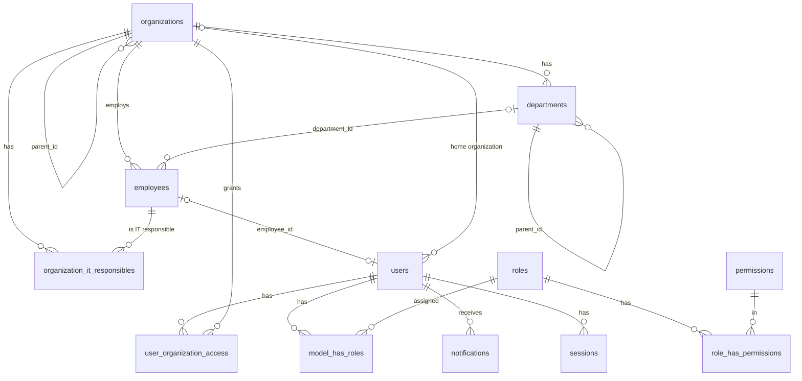

# AT.urtg.uz — Ma'lumotlar bazasi

| | |
|---|---|
| DBMS | MySQL 8.4, InnoDB, `utf8mb4_unicode_ci` |
| Vaqt | Barcha `TIMESTAMP` qiymatlari UTC (`--default-time-zone=+00:00`, `APP_TIMEZONE=UTC`) |
| Holat | 1-bosqich jadvallari — batafsil; keyingi bosqichlar — reja |

## 1. Konvensiyalar

| Qoida | Tafsilot |
|---|---|
| Nomlash | Jadval — ko'plik `snake_case`; FK — `<birlik>_id`; pivot — ikki jadval nomi |
| Birlamchi kalit | `BIGINT UNSIGNED AUTO_INCREMENT` (`id`); `notifications` — UUID (Laravel standarti) |
| Audit ustunlari | `created_at`, `updated_at`, `created_by`, `updated_by` (→ `users.id`, `ON DELETE SET NULL`), `deleted_at` — biznes obyektlarida |
| O'chirish | Biznes obyektlari faqat **soft delete**; jismoniy o'chirish faqat pivot va bog'liq bola yozuvlarda |
| Pul | `DECIMAL(18,2)`, valyuta UZS. `FLOAT/DOUBLE` taqiqlangan |
| Miqdor (ombor) | `DECIMAL(18,3)` — o'lchov birliklari kasr bo'lishi mumkin (metr, kg) |
| Enum | DB'da `VARCHAR(32)`, qiymatlar PHP backed enum orqali nazorat qilinadi (migratsiyasiz qiymat qo'shish uchun) |
| JSON | Faqat tuzilmasi o'zgaruvchan ma'lumot uchun (audit qiymatlari, sozlamalar, texnik xususiyatlar) |
| Unikal + soft delete | Unikal kodlar soft delete qilingan yozuvlar bilan ham to'qnashadi — qayta ishlatish o'rniga yozuvni tiklash (restore) tavsiya etiladi |

### Cascade strategiyasi

| Bog'lanish turi | Strategiya | Misol |
|---|---|---|
| Biznes obyekti → ma'lumotnoma/ota obyekt | `RESTRICT` (o'chirish oldin tekshiriladi, soft delete ishlatiladi) | `employees.organization_id`, `departments.organization_id` |
| Ixtiyoriy bog'lanish | `SET NULL` | `employees.department_id`, `users.employee_id`, `created_by` |
| Pivot / sof bola yozuv | `CASCADE` | `user_organization_access`, `model_has_roles`, `organization_it_responsibles` |
| Audit log | FK yo'q (yozuv obyektdan uzoq yashaydi) + matnli snapshot | `audit_logs.user_id` |

### Tranzaksiyalar

Quyidagilar har doim `DB::transaction` ichida: tashkilotni ko'chirish (path
yangilash), foydalanuvchi + rollar + kirish doirasini yaratish/o'zgartirish,
xodimni ishdan bo'shatish (+ foydalanuvchini faolsizlantirish), har bir
audit yozuvi o'z o'zgarishi bilan. Keyingi bosqichlarda: ombor operatsiyalari
(`SELECT ... FOR UPDATE` bilan), aktiv ko'chirish, talabnoma bosqichlari.

## 2. 1-bosqich ERD

## 3. 1-bosqich jadvallari

### `organizations`

| Ustun | Tur | Izoh |
|---|---|---|
| id | bigint PK | |
| parent_id | bigint NULL FK → organizations.id `RESTRICT` | Ildiz uchun NULL |
| path | varchar(500) | `/1/5/12/` — o'zi bilan birga; INDEX |
| depth | tinyint unsigned | Ildiz = 0 |
| type | varchar(32) | `head_office`, `subsidiary`, `branch`, `other` |
| name | varchar(255) | To'liq nomi |
| short_name | varchar(100) NULL | |
| code | varchar(50) UNIQUE | Ichki kod |
| tin | varchar(9) NULL UNIQUE | STIR/INN |
| address | varchar(500) NULL | |
| phone | varchar(50) NULL | |
| email | varchar(255) NULL | |
| head_name | varchar(255) NULL | Rahbar F.I.Sh. (matn) |
| is_active | boolean default true | Faolsiz tashkilotga yangi yozuv qo'shilmaydi |
| sort_order | int default 0 | |
| created_by, updated_by, timestamps, deleted_at | | |

Indekslar: `path`, `(parent_id, sort_order)`, `is_active`.
O'chirish: bola tashkilotlari, bo'limlari yoki xodimlari bo'lsa — rad etiladi
(faolsizlantirish tavsiya etiladi).

### `departments`

| Ustun | Tur | Izoh |
|---|---|---|
| id | bigint PK | |
| organization_id | FK → organizations `RESTRICT` | |
| parent_id | bigint NULL FK → departments `RESTRICT` | Ichki sho'ba; bir xil tashkilot ichida |
| name | varchar(255) | |
| code | varchar(50) NULL | UNIQUE `(organization_id, code)` |
| phone | varchar(50) NULL | |
| is_active | boolean | |
| sort_order | int | |
| created_by, updated_by, timestamps, deleted_at | | |

### `employees`

| Ustun | Tur | Izoh |
|---|---|---|
| id | bigint PK | |
| organization_id | FK → organizations `RESTRICT` | |
| department_id | FK NULL → departments `SET NULL` | Shu tashkilot bo'limi bo'lishi shart (validatsiya) |
| last_name, first_name | varchar(100) | |
| middle_name | varchar(100) NULL | Otasining ismi |
| position | varchar(255) NULL | Lavozimi |
| personnel_number | varchar(50) NULL | Tabel raqami; UNIQUE `(organization_id, personnel_number)` |
| phone | varchar(50) NULL | |
| internal_phone | varchar(20) NULL | |
| email | varchar(255) NULL | |
| status | varchar(32) | `active`, `on_leave`, `business_trip`, `dismissed` |
| hired_at | date NULL | |
| dismissed_at | date NULL | `dismissed` holatida majburiy |
| notes | text NULL | |
| created_by, updated_by, timestamps, deleted_at | | |

Indekslar: `(organization_id, status)`, `(last_name, first_name)`, `department_id`.

### `organization_it_responsibles`

| Ustun | Tur | Izoh |
|---|---|---|
| id | bigint PK | |
| organization_id | FK → organizations `CASCADE` | |
| employee_id | FK → employees `CASCADE` | Xodim boshqa tashkilotda bo'lishi mumkin (masalan, markaziy AT xodimi) |
| is_primary | boolean | Tashkilotda bittadan ko'p bo'lmaydi (servisda tekshiriladi) |
| assigned_at | date | |
| notes | varchar(500) NULL | |
| created_by, timestamps | | |

UNIQUE `(organization_id, employee_id)`. Tarix audit log orqali saqlanadi.

### `users`

| Ustun | Tur | Izoh |
|---|---|---|
| id | bigint PK | |
| username | varchar(64) UNIQUE | Login; `a-z0-9._-` |
| name | varchar(255) | Ko'rsatiladigan ism |
| email | varchar(255) NULL UNIQUE | Parol tiklash uchun |
| organization_id | FK NULL → organizations `RESTRICT` | Asosiy (uy) tashkiloti. `employee_id` bo'lsa, xodim tashkiloti bilan bir xil bo'lishi shart. NULL faqat tizim hisoblari (Super Admin) uchun |
| employee_id | FK NULL UNIQUE → employees `SET NULL` | 1:1 xodim kartasi |
| password | varchar(255) | Hash |
| locale | varchar(5) default `uz` | |
| is_active | boolean | |
| must_change_password | boolean | |
| password_changed_at | timestamp NULL | Muddati o'tishini hisoblash uchun |
| last_login_at | timestamp NULL | |
| last_login_ip | varchar(45) NULL | |
| two_factor_secret, two_factor_recovery_codes | text NULL (shifrlangan) | MFA uchun zaxira |
| two_factor_confirmed_at | timestamp NULL | |
| remember_token | | |
| created_by, updated_by, timestamps, deleted_at | | |

### `user_organization_access`

| Ustun | Tur | Izoh |
|---|---|---|
| id | bigint PK | |
| user_id | FK → users `CASCADE` | |
| organization_id | FK → organizations `CASCADE` | |
| include_descendants | boolean default false | Quyi tashkilotlar (kelajakdagilari ham) |
| created_by, timestamps | | |

UNIQUE `(user_id, organization_id)`.

### RBAC (`spatie/laravel-permission`)

`roles`, `permissions`, `model_has_roles`, `model_has_permissions`,
`role_has_permissions` — paket standarti. `roles` jadvaliga qo'shimcha:
`display_name varchar(255)`, `description varchar(500) NULL`,
`is_system boolean` (seed qilingan rollarni o'chirib bo'lmaydi).

### `audit_logs`

| Ustun | Tur | Izoh |
|---|---|---|
| id | bigint PK | |
| event | varchar(50) | `created`, `updated`, `deleted`, `restored`, `login`, `logout`, `login_failed`, `password_changed`, `password_reset`, `roles_changed`, `access_changed`, `settings_updated`, `role_permissions_changed` |
| auditable_type | varchar(100) NULL | Morph alias (`organization`, `employee`, ...) |
| auditable_id | bigint NULL | |
| user_id | bigint NULL (FK yo'q) | Kim |
| user_label | varchar(255) NULL | O'sha paytdagi username (snapshot) |
| organization_id | bigint NULL | Doira bo'yicha ko'rish uchun |
| old_values, new_values | json NULL | Faqat o'zgargan maydonlar; maxfiylar chiqarib tashlanadi |
| ip_address | varchar(45) NULL | |
| user_agent | varchar(255) NULL | |
| http_method | varchar(10) NULL | |
| url | varchar(500) NULL | So'rov yo'li (query'siz) |
| request_id | char(36) NULL | Loglar bilan bog'lash |
| created_at | timestamp(3) | |

Indekslar: `(auditable_type, auditable_id)`, `(user_id, created_at)`,
`(organization_id, created_at)`, `(event, created_at)`, `created_at`.
Faqat INSERT; ilova darajasida update/delete taqiqlangan.

### `system_settings`

| Ustun | Tur | Izoh |
|---|---|---|
| id | bigint PK | |
| key | varchar(100) UNIQUE | `general.system_name`, `security.password_min_length` ... |
| value | json | |
| updated_by, timestamps | | |

Sozlamalar ro'yxati, turi, standart qiymati va validatsiyasi kodda
(`config/settings.php`); DB faqat o'zgartirilgan qiymatlarni saqlaydi.

### Laravel standart jadvallari

`sessions` (database drayver, `user_id` indeksli), `password_reset_tokens`,
`personal_access_tokens` (Sanctum), `notifications`, `cache`/`cache_locks`
(zaxira drayver), `jobs`, `job_batches`, `failed_jobs`.

## 4. Rollar va ruxsatlar matritsasi

1-bosqich ruxsatlari (keyingi bosqichlar o'z modullarini qo'shadi):

| Ruxsat | super-admin | central-it-head | central-it-staff | org-it-responsible | org-head | employee | accountant | auditor |
|---|---|---|---|---|---|---|---|---|
| dashboard.view | ✓ | ✓ | ✓ | ✓ | ✓ | ✓ | ✓ | ✓ |
| organizations.view | ✓ | ✓ | ✓ | ✓ | ✓ | | ✓ | ✓ |
| organizations.create / update / delete | ✓ | ✓ | | | | | | |
| organizations.manage_it_staff | ✓ | ✓ | | | | | | |
| departments.view | ✓ | ✓ | ✓ | ✓ | ✓ | | ✓ | ✓ |
| departments.create / update / delete | ✓ | ✓ | | ✓ | | | | |
| employees.view | ✓ | ✓ | ✓ | ✓ | ✓ | | ✓ | ✓ |
| employees.create / update / delete | ✓ | ✓ | ✓ (create/update) | ✓ | | | | |
| users.view | ✓ | ✓ | ✓ | | | | | ✓ |
| users.create / update / deactivate / reset_password | ✓ | ✓ | | | | | | |
| users.manage_access (rollar, tashkilotlar) | ✓ | ✓ | | | | | | |
| roles.view | ✓ | ✓ | | | | | | ✓ |
| roles.manage | ✓ | | | | | | | |
| audit.view | ✓ | ✓ | | | | | | ✓ |
| settings.view | ✓ | ✓ | | | | | | ✓ |
| settings.update | ✓ | | | | | | | |

Ma'lumot **doirasi** rolga emas, `user_organization_access`ga bog'liq.
Rollar nomlari: Super Admin, Markaziy AT rahbari, Markaziy AT xodimi,
Quyi tashkilot AT mas'uli, Quyi tashkilot rahbari, Oddiy xodim,
Buxgalter / moddiy javobgar shaxs, Auditor / kuzatuvchi.

## 5. Keyingi bosqichlar jadvallari (reja)

Har bir bosqich boshida ushbu bo'lim batafsil sxema bilan yangilanadi.
Barcha tashkilotga tegishli jadvallar `organization_id` ustuniga va
`BelongsToOrganization` traitiga ega bo'ladi.

```mermaid
erDiagram
    organizations ||--o{ helpdesk_tickets : ""
    employees ||--o{ helpdesk_tickets : "requester"
    users ||--o{ helpdesk_tickets : "assignee"
    helpdesk_tickets ||--o{ ticket_comments : ""
    helpdesk_tickets ||--o{ ticket_histories : ""
    ticket_categories ||--o{ helpdesk_tickets : ""
    ticket_sla_policies ||--o{ helpdesk_tickets : ""
    organizations ||--o{ assets : ""
    asset_categories ||--o{ assets : ""
    assets ||--o{ asset_assignments : ""
    employees ||--o{ asset_assignments : ""
    assets ||--o{ asset_transfers : ""
    assets ||--o{ asset_maintenance : ""
    assets ||--o| network_devices : "monitoring"
    network_devices ||--o{ monitoring_checks : ""
    network_devices ||--o{ monitoring_events : ""
    assets ||--o| device_agents : ""
    device_agents ||--o{ agent_checkins : ""
    assets ||--o{ software_installations : ""
    software_catalog ||--o{ software_installations : ""
    software_catalog ||--o{ software_licenses : ""
    mobile_operators ||--o{ sim_cards : ""
    sim_cards ||--o{ sim_assignments : ""
    service_providers ||--o{ service_contracts : ""
    service_contracts ||--o{ service_invoices : ""
    service_invoices ||--o{ service_payments : ""
    warehouses ||--o{ stock_balances : ""
    inventory_items ||--o{ stock_balances : ""
    inventory_items ||--o{ stock_movements : ""
    requisitions ||--o{ requisition_items : ""
    requisitions ||--o{ requisition_approvals : ""
    requisition_items ||--o{ requisition_fulfillments : ""
    task_boards ||--o{ task_columns : ""
    task_columns ||--o{ tasks : ""
    assets ||--o| printers : ""
    printer_models ||--o{ printer_cartridge_compatibilities : ""
    cartridge_models ||--o{ printer_cartridge_compatibilities : ""
    documents ||--o{ document_links : ""
```

| Bosqich | Jadvallar |
|---|---|
| 2 — Helpdesk | ticket_categories, ticket_sla_policies, helpdesk_tickets, ticket_comments (`is_internal`), ticket_attachments, ticket_histories, ticket_links (takroriy muammolar), ticket_ratings; documents, document_links, document_versions; report_exports |
| 3 — Aktivlar | asset_categories, manufacturers, asset_models, locations, assets, asset_assignments, asset_transfers (+ dalolatnoma), asset_maintenance, asset_disposals, inventory_sessions, inventory_session_items |
| 4 — Ombor, talabnomalar | warehouses, units, inventory_items (`track_batches`, `min_quantity`), stock_balances (`warehouse_id, item_id, batch` UNIQUE, `quantity DECIMAL(18,3)` CHECK ≥ 0), stock_movements (yagona jurnal), stock_receipts, stock_issues, stock_transfers; requisitions, requisition_items, requisition_approvals, requisition_histories, requisition_fulfillments |
| 5 — Monitoring, dasturlar | monitoring_policies, network_devices, monitoring_checks (partitsiya/retention), monitoring_events, monitoring_allowlist (CIDR); software_catalog, software_licenses, software_installations, software_policies, antivirus_statuses, device_agents, agent_tokens (hash), agent_checkins |
| 6 — SIM, xizmatlar | mobile_operators, sim_cards (ICCID shifrlangan), sim_assignments, sim_histories, sim_requests; service_providers, service_contracts, service_services, service_invoices, service_payments |
| 7 — Kanban va boshqalar | task_boards, task_columns, tasks, task_assignees, task_watchers, task_comments, task_checklists, task_labels, task_label_task, task_recurrences; printers, printer_models, cartridge_models, printer_cartridge_compatibilities, cartridge_movements, printer_counters; kb_articles, changes, problems, maintenance_plans, security_incidents, backup_jobs, backup_checks |
