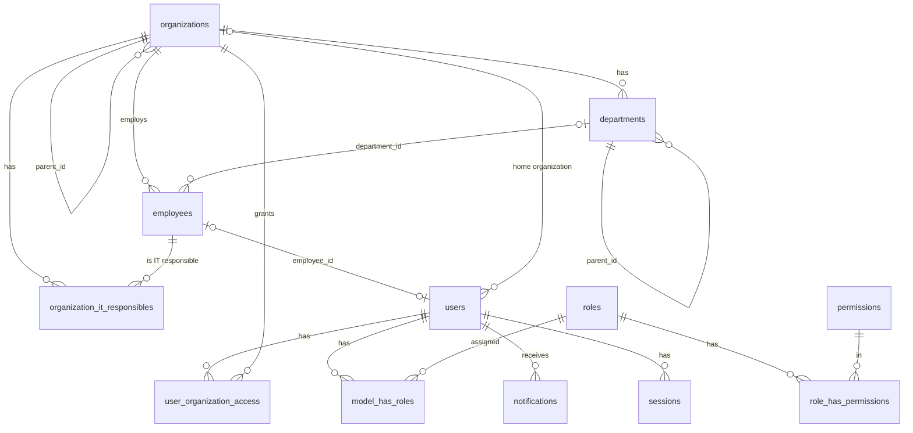
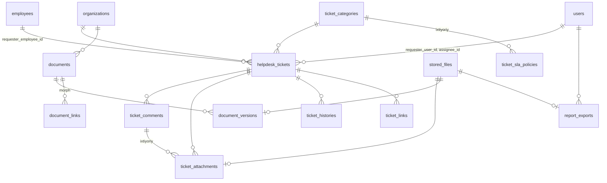
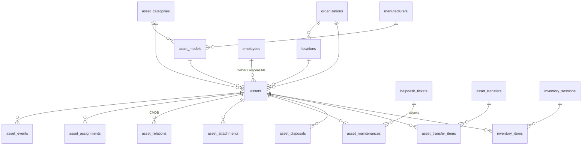
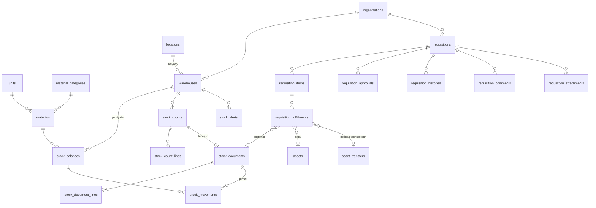
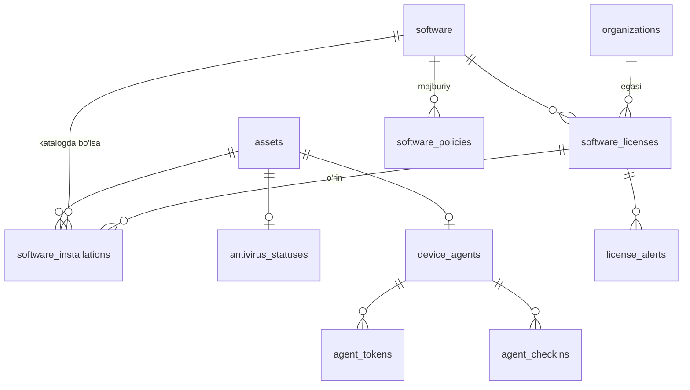
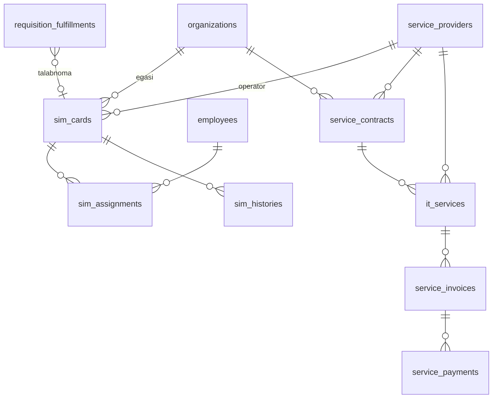
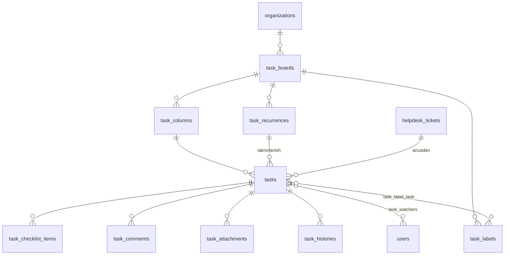
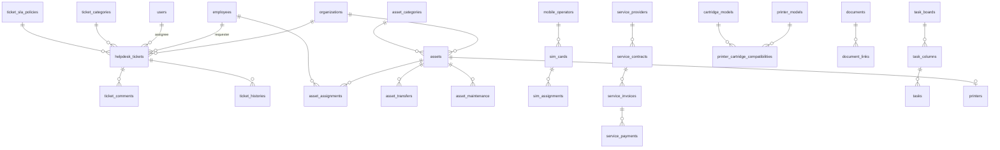

# AT.urtg.uz — Ma'lumotlar bazasi

| | |
|---|---|
| DBMS | MySQL 8.4, InnoDB, `utf8mb4_unicode_ci` |
| Vaqt | Barcha `TIMESTAMP` qiymatlari UTC (`--default-time-zone=+00:00`, `APP_TIMEZONE=UTC`) |
| Holat | 1-bosqich jadvallari — batafsil; keyingi bosqichlar — reja |

## 1. Konvensiyalar

| Qoida | Tafsilot |
|---|---|
| Nomlash | Jadval — ko'plik `snake_case`; FK — `<birlik>_id`; pivot — ikki jadval nomi |
| Birlamchi kalit | `BIGINT UNSIGNED AUTO_INCREMENT` (`id`); `notifications` — UUID (Laravel standarti) |
| Audit ustunlari | `created_at`, `updated_at`, `created_by`, `updated_by` (→ `users.id`, `ON DELETE SET NULL`), `deleted_at` — biznes obyektlarida |
| O'chirish | Biznes obyektlari faqat **soft delete**; jismoniy o'chirish faqat pivot va bog'liq bola yozuvlarda |
| Pul | `DECIMAL(18,2)`, valyuta UZS. `FLOAT/DOUBLE` taqiqlangan |
| Miqdor (ombor) | `DECIMAL(18,3)` — o'lchov birliklari kasr bo'lishi mumkin (metr, kg) |
| Enum | DB'da `VARCHAR(32)`, qiymatlar PHP backed enum orqali nazorat qilinadi (migratsiyasiz qiymat qo'shish uchun) |
| JSON | Faqat tuzilmasi o'zgaruvchan ma'lumot uchun (audit qiymatlari, sozlamalar, texnik xususiyatlar) |
| Unikal + soft delete | Unikal kodlar soft delete qilingan yozuvlar bilan ham to'qnashadi — qayta ishlatish o'rniga yozuvni tiklash (restore) tavsiya etiladi |

### Cascade strategiyasi

| Bog'lanish turi | Strategiya | Misol |
|---|---|---|
| Biznes obyekti → ma'lumotnoma/ota obyekt | `RESTRICT` (o'chirish oldin tekshiriladi, soft delete ishlatiladi) | `employees.organization_id`, `departments.organization_id` |
| Ixtiyoriy bog'lanish | `SET NULL` | `employees.department_id`, `users.employee_id`, `created_by` |
| Pivot / sof bola yozuv | `CASCADE` | `user_organization_access`, `model_has_roles`, `organization_it_responsibles` |
| Audit log | FK yo'q (yozuv obyektdan uzoq yashaydi) + matnli snapshot | `audit_logs.user_id` |

### Tranzaksiyalar

Quyidagilar har doim `DB::transaction` ichida: tashkilotni ko'chirish (path
yangilash), foydalanuvchi + rollar + kirish doirasini yaratish/o'zgartirish,
xodimni ishdan bo'shatish (+ foydalanuvchini faolsizlantirish), har bir
audit yozuvi o'z o'zgarishi bilan. Keyingi bosqichlarda: ombor operatsiyalari
(`SELECT ... FOR UPDATE` bilan), aktiv ko'chirish, talabnoma bosqichlari.

## 2. 1-bosqich ERD

## 3. 1-bosqich jadvallari

### `organizations`

| Ustun | Tur | Izoh |
|---|---|---|
| id | bigint PK | |
| parent_id | bigint NULL FK → organizations.id `RESTRICT` | Ildiz uchun NULL |
| path | varchar(500) | `/1/5/12/` — o'zi bilan birga; INDEX |
| depth | tinyint unsigned | Ildiz = 0 |
| type | varchar(32) | `head_office`, `subsidiary`, `branch`, `other` |
| name | varchar(255) | To'liq nomi |
| short_name | varchar(100) NULL | |
| code | varchar(50) UNIQUE | Ichki kod |
| tin | varchar(9) NULL UNIQUE | STIR/INN |
| address | varchar(500) NULL | |
| phone | varchar(50) NULL | |
| email | varchar(255) NULL | |
| head_name | varchar(255) NULL | Rahbar F.I.Sh. (matn) |
| is_active | boolean default true | Faolsiz tashkilotga yangi yozuv qo'shilmaydi |
| sort_order | int default 0 | |
| created_by, updated_by, timestamps, deleted_at | | |

Indekslar: `path`, `(parent_id, sort_order)`, `is_active`.
O'chirish: bola tashkilotlari, bo'limlari yoki xodimlari bo'lsa — rad etiladi
(faolsizlantirish tavsiya etiladi).

### `departments`

| Ustun | Tur | Izoh |
|---|---|---|
| id | bigint PK | |
| organization_id | FK → organizations `RESTRICT` | |
| parent_id | bigint NULL FK → departments `RESTRICT` | Ichki sho'ba; bir xil tashkilot ichida |
| name | varchar(255) | |
| code | varchar(50) NULL | UNIQUE `(organization_id, code)` |
| phone | varchar(50) NULL | |
| is_active | boolean | |
| sort_order | int | |
| created_by, updated_by, timestamps, deleted_at | | |

### `employees`

| Ustun | Tur | Izoh |
|---|---|---|
| id | bigint PK | |
| organization_id | FK → organizations `RESTRICT` | |
| department_id | FK NULL → departments `SET NULL` | Shu tashkilot bo'limi bo'lishi shart (validatsiya) |
| last_name, first_name | varchar(100) | |
| middle_name | varchar(100) NULL | Otasining ismi |
| position | varchar(255) NULL | Lavozimi |
| personnel_number | varchar(50) NULL | Tabel raqami; UNIQUE `(organization_id, personnel_number)` |
| phone | varchar(50) NULL | |
| internal_phone | varchar(20) NULL | |
| email | varchar(255) NULL | |
| status | varchar(32) | `active`, `on_leave`, `business_trip`, `dismissed` |
| hired_at | date NULL | |
| dismissed_at | date NULL | `dismissed` holatida majburiy |
| notes | text NULL | |
| created_by, updated_by, timestamps, deleted_at | | |

Indekslar: `(organization_id, status)`, `(last_name, first_name)`, `department_id`.

### `organization_it_responsibles`

| Ustun | Tur | Izoh |
|---|---|---|
| id | bigint PK | |
| organization_id | FK → organizations `CASCADE` | |
| employee_id | FK → employees `CASCADE` | Xodim boshqa tashkilotda bo'lishi mumkin (masalan, markaziy AT xodimi) |
| is_primary | boolean | Tashkilotda bittadan ko'p bo'lmaydi (servisda tekshiriladi) |
| assigned_at | date | |
| notes | varchar(500) NULL | |
| created_by, timestamps | | |

UNIQUE `(organization_id, employee_id)`. Tarix audit log orqali saqlanadi.

### `users`

| Ustun | Tur | Izoh |
|---|---|---|
| id | bigint PK | |
| username | varchar(64) UNIQUE | Login; `a-z0-9._-` |
| name | varchar(255) | Ko'rsatiladigan ism |
| email | varchar(255) NULL UNIQUE | Parol tiklash uchun |
| organization_id | FK NULL → organizations `RESTRICT` | Asosiy (uy) tashkiloti. `employee_id` bo'lsa, xodim tashkiloti bilan bir xil bo'lishi shart. NULL faqat tizim hisoblari (Super Admin) uchun |
| employee_id | FK NULL UNIQUE → employees `SET NULL` | 1:1 xodim kartasi |
| password | varchar(255) | Hash |
| locale | varchar(5) default `uz` | |
| is_active | boolean | |
| must_change_password | boolean | |
| password_changed_at | timestamp NULL | Muddati o'tishini hisoblash uchun |
| last_login_at | timestamp NULL | |
| last_login_ip | varchar(45) NULL | |
| two_factor_secret, two_factor_recovery_codes | text NULL (shifrlangan) | MFA uchun zaxira |
| two_factor_confirmed_at | timestamp NULL | |
| remember_token | | |
| created_by, updated_by, timestamps, deleted_at | | |

### `user_organization_access`

| Ustun | Tur | Izoh |
|---|---|---|
| id | bigint PK | |
| user_id | FK → users `CASCADE` | |
| organization_id | FK → organizations `CASCADE` | |
| include_descendants | boolean default false | Quyi tashkilotlar (kelajakdagilari ham) |
| created_by, timestamps | | |

UNIQUE `(user_id, organization_id)`.

### RBAC (`spatie/laravel-permission`)

`roles`, `permissions`, `model_has_roles`, `model_has_permissions`,
`role_has_permissions` — paket standarti. `roles` jadvaliga qo'shimcha:
`display_name varchar(255)`, `description varchar(500) NULL`,
`is_system boolean` (seed qilingan rollarni o'chirib bo'lmaydi).

### `audit_logs`

| Ustun | Tur | Izoh |
|---|---|---|
| id | bigint PK | |
| event | varchar(50) | `created`, `updated`, `deleted`, `restored`, `login`, `logout`, `login_failed`, `password_changed`, `password_reset`, `roles_changed`, `access_changed`, `settings_updated`, `role_permissions_changed` |
| auditable_type | varchar(100) NULL | Morph alias (`organization`, `employee`, ...) |
| auditable_id | bigint NULL | |
| user_id | bigint NULL (FK yo'q) | Kim |
| user_label | varchar(255) NULL | O'sha paytdagi username (snapshot) |
| organization_id | bigint NULL | Doira bo'yicha ko'rish uchun |
| old_values, new_values | json NULL | Faqat o'zgargan maydonlar; maxfiylar chiqarib tashlanadi |
| ip_address | varchar(45) NULL | |
| user_agent | varchar(255) NULL | |
| http_method | varchar(10) NULL | |
| url | varchar(500) NULL | So'rov yo'li (query'siz) |
| request_id | char(36) NULL | Loglar bilan bog'lash |
| created_at | timestamp(3) | |

Indekslar: `(auditable_type, auditable_id)`, `(user_id, created_at)`,
`(organization_id, created_at)`, `(event, created_at)`, `created_at`.
Faqat INSERT; ilova darajasida update/delete taqiqlangan.

### `system_settings`

| Ustun | Tur | Izoh |
|---|---|---|
| id | bigint PK | |
| key | varchar(100) UNIQUE | `general.system_name`, `security.password_min_length` ... |
| value | json | |
| updated_by, timestamps | | |

Sozlamalar ro'yxati, turi, standart qiymati va validatsiyasi kodda
(`config/settings.php`); DB faqat o'zgartirilgan qiymatlarni saqlaydi.

### Laravel standart jadvallari

`sessions` (database drayver, `user_id` indeksli), `password_reset_tokens`,
`personal_access_tokens` (Sanctum), `notifications`, `cache`/`cache_locks`
(zaxira drayver), `jobs`, `job_batches`, `failed_jobs`.

## 4. Rollar va ruxsatlar matritsasi

1–5-bosqich ruxsatlari (keyingi bosqichlar o'z modullarini qo'shadi). Ruxsatsiz ham har bir foydalanuvchi o'zi yuborgan arizalarni ko'radi.

| Ruxsat | super-admin | central-it-head | central-it-staff | org-it-responsible | org-head | employee | accountant | auditor |
|---|---|---|---|---|---|---|---|---|
| dashboard.view | ✓ | ✓ | ✓ | ✓ | ✓ | ✓ | ✓ | ✓ |
| organizations.view | ✓ | ✓ | ✓ | ✓ | ✓ | | ✓ | ✓ |
| organizations.create / update / delete | ✓ | ✓ | | | | | | |
| organizations.manage_it_staff | ✓ | ✓ | | | | | | |
| departments.view | ✓ | ✓ | ✓ | ✓ | ✓ | | ✓ | ✓ |
| departments.create / update / delete | ✓ | ✓ | | ✓ | | | | |
| employees.view | ✓ | ✓ | ✓ | ✓ | ✓ | | ✓ | ✓ |
| employees.create / update / delete | ✓ | ✓ | ✓ (create/update) | ✓ | | | | |
| users.view | ✓ | ✓ | ✓ | | | | | ✓ |
| users.create / update / deactivate / reset_password | ✓ | ✓ | | | | | | |
| users.manage_access (rollar, tashkilotlar) | ✓ | ✓ | | | | | | |
| roles.view | ✓ | ✓ | | | | | | ✓ |
| roles.manage | ✓ | | | | | | | |
| audit.view | ✓ | ✓ | | | | | | ✓ |
| settings.view | ✓ | ✓ | | | | | | ✓ |
| settings.update | ✓ | | | | | | | |
| helpdesk.create (ariza yuborish) | ✓ | ✓ | ✓ | ✓ | ✓ | ✓ | ✓ | |
| helpdesk.view (doiradagi barcha arizalar) | ✓ | ✓ | ✓ | ✓ | ✓ | | | ✓ |
| helpdesk.process (bajarish, izoh, vaqt) | ✓ | ✓ | ✓ | ✓ | | | | |
| helpdesk.assign (mas'ul tayinlash) | ✓ | ✓ | | ✓ | | | | |
| helpdesk.export (Excel/PDF) | ✓ | ✓ | ✓ | ✓ | ✓ | | | ✓ |
| helpdesk.manage (kategoriya, SLA, kalendar) | ✓ | ✓ | | | | | | |
| documents.view | ✓ | ✓ | ✓ | ✓ | | | ✓ | ✓ |
| documents.manage | ✓ | ✓ | ✓ | ✓ | | | ✓ | |
| assets.view / export | ✓ | ✓ | ✓ | ✓ | ✓ | | ✓ | ✓ |
| assets.create / update / assign / transfer | ✓ | ✓ | ✓ | ✓ | | | | |
| assets.inventory | ✓ | ✓ | ✓ | ✓ | | | ✓ | |
| assets.delete / dispose (tasdiqlash) / manage_catalog | ✓ | ✓ | | | | | | |
| warehouse.view / export | ✓ | ✓ | ✓ | ✓ | ✓ | | ✓ | ✓ |
| warehouse.receive / issue / inventory | ✓ | ✓ | ✓ | ✓ | | | ✓ | |
| warehouse.transfer | ✓ | ✓ | ✓ | ✓ | | | | |
| warehouse.manage (katalog, omborlar, qo'lda tuzatish) | ✓ | ✓ | | | | | | |
| requisitions.view | ✓ | ✓ | ✓ | ✓ | ✓ | | ✓ | ✓ |
| requisitions.create | ✓ | ✓ | | ✓ | | | | |
| requisitions.approve_org (tashkilot rahbari bosqichi) | ✓ | | | | ✓ | | | |
| requisitions.review | ✓ | ✓ | ✓ | | | | | |
| requisitions.approve (markaziy qaror) | ✓ | ✓ | | | | | | |
| requisitions.fulfill (ajratish) | ✓ | ✓ | ✓ | | | | ✓ | |
| requisitions.export | ✓ | ✓ | | | | | | ✓ |
| software.view | ✓ | ✓ | ✓ | ✓ | ✓ | | ✓ | ✓ |
| software.install (qurilma dasturlari, antivirus, CSV) | ✓ | ✓ | ✓ | ✓ | | | | |
| software.manage (katalog, litsenziyalar, siyosatlar) | ✓ | ✓ | | | | | | |
| software.agents (agent va tokenlar) | ✓ | ✓ | ✓ | | | | | |
| software.export | ✓ | ✓ | ✓ | ✓ | ✓ | | | ✓ |

Ma'lumot **doirasi** rolga emas, `user_organization_access`ga bog'liq.
Rollar nomlari: Super Admin, Markaziy AT rahbari, Markaziy AT xodimi,
Quyi tashkilot AT mas'uli, Quyi tashkilot rahbari, Oddiy xodim,
Buxgalter / moddiy javobgar shaxs, Auditor / kuzatuvchi.

## 5. 2-bosqich jadvallari (Helpdesk, fayllar, hujjatlar, eksport)

### `stored_files`
Private diskdagi fayl: `uuid` (yuklab olish kaliti), `disk`, `path` (`files/Y/m/<uuid>`, kengaytmasiz),
`original_name`, `mime` (fayl baytlaridan aniqlangan), `extension`, `size`, `sha256`,
`organization_id?`, `uploaded_by?`. Yuklab olish faqat `/files/{uuid}` orqali; ruxsatni egasi
(ariza ilovasi, hujjat versiyasi, eksport) belgilaydi (`FileAccess`).

### `ticket_categories`
`code` (unique, seed), `name`, `name_ru?`, `description?`, `is_active`, `sort_order`, user stamps.
Arizasi bor kategoriya o'chirilmaydi (409) — faolsizlantiriladi.

### `ticket_sla_policies`
`priority` (`low|normal|high|critical`), `category_id?` (NULL — ustuvorlik bo'yicha umumiy),
`response_minutes`, `resolution_minutes` (**ish daqiqalari**). Tanlash tartibi: kategoriya+ustuvorlik →
ustuvorlik → `config/helpdesk.php` standartlari (30/240, 60/480, 120/1440, 480/2400).

### `ticket_counters`
`year` (PK), `last_number`. `HD-YYYY-NNNNNN` raqami `FOR UPDATE` qulfi bilan beriladi (yil — Toshkent vaqti).

### `helpdesk_tickets`
| Ustun | Izoh |
|---|---|
| `number` | unique, `HD-2026-000001` |
| `organization_id`, `department_id?` | tashkilot doirasi |
| `requester_employee_id?`, `requester_user_id?` | murojaatchi (xodim / tizim foydalanuvchisi) |
| `contact_name/phone/email`, `location` | aloqa |
| `category_id`, `title`, `description`, `priority`, `status` | `status`: new, in_review, assigned, in_progress, waiting_user, resolved, closed, rejected |
| `assignee_id?`, `assigned_at?` | mas'ul |
| `sla_response_minutes`, `sla_resolution_minutes` | yaratilgandagi SLA nusxasi |
| `response_due_at`, `resolution_due_at` | ish vaqti bo'yicha hisoblangan muddatlar |
| `first_response_at?`, `response_breached_at?`, `resolution_breached_at?`, `due_soon_notified_at?` | SLA belgilari (bir martalik) |
| `paused_at?`, `paused_minutes` | `waiting_user` pauzasi (ish daqiqalari) |
| `resolved_at?`, `closed_at?`, `rejected_at?`, `resolution?`, `reject_reason?` | yakun |
| `rating?` (1–5), `rating_comment?`, `rated_at?`, `reopened_count`, `time_spent_minutes` | |

Muddat formulasi: `resolution_due_at = BusinessCalendar::addMinutes(created_at, sla_resolution_minutes + paused_minutes)`.
Indekslar: `(organization_id, status)`, `(assignee_id, status)`, `(requester_user_id, status)`, `(status, resolution_due_at)`, `created_at`.

### `ticket_comments`, `ticket_attachments`, `ticket_histories`, `ticket_links`
- `ticket_comments`: `ticket_id`, `user_id?`, `body`, `is_internal` (faqat bajaruvchilarga ko'rinadi).
- `ticket_attachments`: `ticket_id`, `comment_id?`, `stored_file_id` (unique), `user_id?`.
- `ticket_histories`: append-only — `action` (created, updated, status_changed, assigned, commented,
  attachment_added/removed, time_logged, rated, linked/unlinked, sla_breached, auto_closed), `old_values`,
  `new_values`, `note`, `is_internal`. Arizalar uchun audit jurnali vazifasini bajaradi.
- `ticket_links`: `ticket_id`, `linked_ticket_id`, `type` (`relates|duplicates`), bir juftlik bir marta.

### `documents`, `document_versions`, `document_links`
- `documents`: `organization_id`, `type` (contract, act, requisition, invoice, technical_passport, warranty,
  order, letter, other), `number?`, `title`, `document_date?`, `description?`, `current_version_id?`, soft delete, audit.
- `document_versions`: `document_id`, `version` (1, 2, …; unique), `stored_file_id`, `note?`, `uploaded_by?`.
- `document_links`: `document_id`, `linkable_type` (morph alias, hozircha `ticket`), `linkable_id`.

### `report_exports`
`uuid`, `user_id`, `type` (`helpdesk_tickets`), `format` (`xlsx|pdf`), `filters` (json), `status`
(pending, processing, done, failed), `stored_file_id?`, `row_count?`, `error?`, `started_at?`, `finished_at?`.
7 kundan keyin `exports:prune` o'chiradi.

### `users` (qo'shimcha)
`notification_preferences` (json): `{"mail_muted": ["ticket_commented", …]}`.

## 6. 3-bosqich jadvallari (IT aktivlar va CMDB)

| Jadval | Asosiy ustunlar / qoidalar |
|---|---|
| `number_sequences` | `key` (PK, masalan `asset`, `transfer:2026`), `last_number` — bitta `INSERT … ON DUPLICATE KEY UPDATE` bilan, tranzaksiya ichida (bo'shliqsiz) |
| `asset_categories` | `code` (seed, spec §5.4 dagi 10 guruh), `name`, `name_ru`, `is_networked` (5-bosqich monitoringi uchun), `is_active`, `sort_order` |
| `manufacturers`, `asset_models` | ishlab chiqaruvchi (unique nom); model = ishlab chiqaruvchi + toifa + nom (+ `specs`) |
| `locations` | `organization_id`, `parent_id?` (bino → xona, shu tashkilot ichida), `name`, `code?` |
| `assets` | `inventory_number` (unique; bo'sh bo'lsa `AT-NNNNNN`), `organization_id`, `department_id?`, `category_id`, `manufacturer_id?`, `model_id?`, `serial_number`, `hostname`, `ip_address`, `mac_address` (`AA:BB:…`), `vlan`, `subnet`, `status` (in_stock, in_use, in_repair, reserve, written_off, lost), `previous_status` (ta'mirdan keyin tiklash), `holder_employee_id`, `responsible_employee_id` (moddiy javobgar), `location_id`, `room`, `purchase_date`, `warranty_until`, `warranty_notified_for`, `cost` decimal(15,2), `supplier`, `specs`, `notes`, `transfer_id` (ochiq ko'chirishda — aktiv faqat o'qiladi) |
| `asset_events` | append-only tarix: created, updated, status_changed, assigned, returned, transferred, maintenance_opened/closed, disposal_requested/approved/rejected, relation_added/removed, attachment_added/removed, inventory_found |
| `asset_assignments` | `asset_id`, `organization_id`, `employee_id`, `assigned_at/by`, `returned_at/by`, izohlar (ochiq = `returned_at IS NULL`) |
| `asset_relations` | `asset_id → related_asset_id`, `type` (connected_to, installed_in, part_of, depends_on), `note` (port/slot) |
| `asset_attachments` | aktiv fayllari (`stored_files`, private) |
| `asset_maintenances` | `status` (open/closed), `started_at`, `finished_at`, `vendor`, `description`, `result`, `cost`, `ticket_id?` |
| `asset_disposals` | `status` (pending/approved/rejected), `reason`, `act_number`, so'rovchi va qaror qiluvchi |
| `asset_transfers` (+ `asset_transfer_items`) | `number` `TR-YYYY-NNNNN`, `from_/to_organization_id`, `status` (draft → sent → received / cancelled), `act_file_id` (dalolatnoma PDF), kim/qachon |
| `inventory_sessions` (+ `inventory_items`) | tashkilot (+ quyi tashkilotlar), `status` (open/closed), hisoblagichlar; item: `inventory_number`, `expected`, `found_at`, `asset_id?` |

## 7. 4-bosqich jadvallari (Ombor va talabnomalar)

| Jadval | Asosiy ustunlar / qoidalar |
|---|---|
| `units`, `material_categories` | seed (`config/warehouse.php`): dona, quti, pachka, metr, kg, litr, komplekt; spec §5.9 dagi 6 toifa. `code` unique, `name`, `name_ru`, `is_active`, `sort_order` |
| `materials` | `code` unique (bo'sh bo'lsa `MT-NNNNN`), `name`, `category_id`, `unit_id`, `track_batches`, `track_expiry` (faqat partiya bilan), `min_quantity` DECIMAL(18,3). Qoldig'i bor materialda partiya/muddat belgilarini o'zgartirib bo'lmaydi |
| `warehouses` | `organization_id` (doira), `name` (tashkilot ichida unique), `code`, `location_id?`, `responsible_user_id?`, `is_active` |
| `stock_balances` | **partiya (lot)**: `warehouse_id, material_id, batch` UNIQUE (`batch=''` — partiyasiz material), `expires_at`, `quantity` DECIMAL(18,3) **CHECK (quantity >= 0)**, `unit_cost` (partiya ichida o'rtacha), `received_at` (FIFO tartibi). Faqat `StockService` o'zgartiradi |
| `stock_documents` | `number` `RC/IS/RT/TF/AD-YYYY-NNNNN`, `type` (receipt, issue, return, transfer, adjustment), `organization_id` (manba ombor tashkiloti), `warehouse_id`, `target_warehouse_id` + `target_organization_id` (ko'chirish), `document_date`, `supplier`, `supplier_document`, `recipient_organization_id`, `recipient_employee_id`, `asset_id` (qurilma), `reason`, `related_document_id` (qaytarish → chiqim), `stock_count_id`, `requisition_id`, `file_id` (skan hujjat), `total_amount`. Joylangandan keyin o'zgarmaydi |
| `stock_document_lines` | foydalanuvchi kiritgan qatorlar: `material_id`, `batch?` (chiqimda bo'sh = FIFO), `expires_at`, `quantity` (faqat tuzatishda ishorali), `unit_cost`, `amount` |
| `stock_movements` | **yagona jurnal**: har bir partiya o'zgarishi — `document_id`, `line_id`, `warehouse_id`, `material_id`, `balance_id`, `batch`, `quantity` (±), `unit_cost`, `balance_after`, `created_by`, `created_at` |
| `stock_counts` (+ `stock_count_lines`) | `number` `SC-YYYY-NNNNN`, `status` (open, closed, cancelled), `open_key` (ochiq paytda = ombor id, UNIQUE — bitta ochiq sanoq), boshlanganda partiyalar surati (`expected_quantity`, `unit_cost`), `counted_quantity`; yopilganda farqlar bitta tuzatish hujjatiga (`adjustment_document_id`) |
| `stock_alerts` | `type` (low_stock, expiring), `warehouse_id`, `material_id`, `batch`, `expires_at`, `quantity`, `open_key` (ochiq epizodda UNIQUE, keyin NULL) — bir epizodga bitta bildirishnoma |
| `requisitions` | `number` `RQ-YYYY-NNNNN`, `organization_id`, `title`, `description`, `status` (draft, submitted, org_approval, central_review, info_requested, approved, rejected, ready_for_allocation, partially_fulfilled, fulfilled, received, closed), `needed_by`, `requester_id`, `recipient_employee_id`, `reviewer_id`, `approved_by/at`, `rejection_reason`, `received_by/at`, `closed_by/at` |
| `requisition_items` | `kind` (equipment, network, consumable, sim, internet, software, repair, other), `material_id?`, `asset_category_id?`, `name`, `quantity`, `approved_quantity` (rahbar kamaytirishi mumkin), `fulfilled_quantity`, `unit_id` |
| `requisition_approvals` | `stage` (org_head, central_head), `decision` (approved, rejected, returned), `user_id`, `comment` |
| `requisition_histories` | append-only: created, updated, submitted, approval_skipped, org_approved, org_rejected, returned, taken, info_requested, info_provided, approved, rejected, ready, allocated, completed, received, closed, file_added; `from_status`, `to_status`, `comment`, `payload` |
| `requisition_comments`, `requisition_attachments` | izohlar; fayllar (`stored_files`, private, FileAccess) |
| `requisition_fulfillments` | `item_id`, `type` (stock, asset, note), `quantity`, `stock_document_id?` (chiqim yoki ko'chirish), `asset_id?`, `asset_transfer_id?` (aktiv boshqa tashkilotdan kelsa), `note`, `fulfilled_by` |

**Parallel operatsiyalar.** Har bir hujjat bitta tranzaksiyada: ishtirok etuvchi omborlar `SELECT … FOR UPDATE` bilan
id tartibida qulflanadi (bitta omborda ketma-ketlik, deadlock yo'q), partiyalar ham `FOR UPDATE` bilan o'qiladi, kamayish
faqat `quantity >= so'ralgan` tekshiruvidan keyin; oxirgi himoya — DB `CHECK`. Talabnoma ajratishi talabnoma qatorini
qulflaydi (tasdiqlangan qoldiqdan oshmaydi). FIFO: avval eng yaqin muddat, keyin eng eski partiya; har bir harakatda narx
saqlanadi — baholash usulini keyin almashtirish mumkin.

## 8. 5-bosqich jadvallari (Dasturlar, litsenziyalar, antivirus, agentlar)

| Jadval | Asosiy ustunlar / qoidalar |
|---|---|
| `software` | katalog: `name`, `normalized_name` (UNIQUE — kichik harf, bo'shliqlar bitta), `vendor`, `category` (os, office, antivirus, browser, security, utility, development, business, other), `license_type` (freeware, open_source, commercial, subscription, oem), `is_antivirus`, `is_active` |
| `software_licenses` | `software_id`, `organization_id` (egasi, doira), `number`, `license_key` (**shifrlangan**, ro'yxatda faqat niqoblangan; ochish audit qilinadi), `seats` ≥ 1, `valid_from`, `expires_at`, `supplier`, `cost`. Band o'rin = bog'langan o'rnatishlar; qulf ostida tekshiriladi |
| `software_installations` | qurilmadagi dastur: `asset_id`, `software_id?` (katalogda bo'lmasa NULL — "tanilmagan nom"), `name`, `normalized_name` (`asset_id + normalized_name` UNIQUE), `vendor`, `version`, `source` (manual, csv, agent), `license_id?`, `installed_at`, `last_seen_at` |
| `software_policies` | majburiy dastur: `software_id`, `organization_id?` (daraxt; NULL — hammasi), `asset_category_id?` (NULL — `config/software.php` dagi kompyuter/server toifalari) |
| `antivirus_statuses` | qurilmaga bitta: `software_id?`/`product_name`, `state` (installed, not_installed), `definitions_updated_at`, `last_scan_at`, `reported_at`, `source`. Ko'rinadigan holat hisoblanadi: hisobot 30 kundan eski → noma'lum; bazalar `software.av_outdated_days` (7) dan eski → eskirgan; aks holda yangilangan / o'rnatilgan / o'rnatilmagan |
| `device_agents` | qurilmaga bitta agent: `name`, `platform`, `agent_version`, `is_active`, `last_checkin_at`, `last_ip` |
| `agent_tokens` | `token_hash` (SHA-256, UNIQUE — ochiq qiymat saqlanmaydi, bir marta ko'rsatiladi), `prefix` (`atg_…`, tanib olish uchun), `last_used_at`, `revoked_at`. Yangi token eskisini bekor qiladi |
| `agent_checkins` | jurnal: `status` (accepted, rejected), `software_count`, `message`, `ip`, `received_at` |
| `license_alerts` | `license_id + expires_at` UNIQUE — muddat ogohlantirishi bir marta |
| `assets.software_inventoried_at` | oxirgi dastur inventarizatsiyasi (agent yoki CSV) |

ICMP tarmoq monitoringi (spec §5.6) foydalanuvchi qarori bilan loyihadan chiqarildi (2026-11-08).

## 9. 6-bosqich jadvallari (SIM-kartalar, xizmatlar va to'lovlar)

| Jadval | Asosiy ustunlar / qoidalar |
|---|---|
| `service_providers` | operatorlar va provayderlar yagona ro'yxati: `name` (UNIQUE), `tin`, `phone`, `email`, `address`, `is_mobile_operator` (SIM uchun), `is_active`. Uzmobile, Beeline, Ucell, Mobiuz seeder bilan (barcha muhitlarda, tahrirlar saqlanadi) |
| `sim_cards` | `organization_id` (egasi, doira), `provider_id`, `phone_number` (`998XXXXXXXXX`), `phone_key` (bekor qilinmagan kartada = raqam, UNIQUE — bitta raqamga bitta jonli karta), `iccid` (**shifrlangan**), `iccid_hash` (HMAC, UNIQUE, qidiruv uchun), `iccid_last4`, `tariff`, `account_number`, `monthly_fee`, `department_id?`, `employee_id?`, `status` (in_stock, active, blocked, cancelled, returned), `previous_status` (blokdan chiqishda), `allocated_at`, `returned_at` |
| `sim_assignments` | foydalanish davrlari: `employee_id?`, `department_id?`, `assigned_at`, `returned_at`, kim berdi/qaytardi |
| `sim_histories` | har hodisa: `event` (registered, updated, assigned, returned, blocked, unblocked, transferred, allocated, cancelled, replaced), `payload` (ICCID faqat oxirgi 4 raqam), `requisition_id?`, `user_id` |
| `service_contracts` | `organization_id`, `provider_id`, `number` (provayder ichida UNIQUE), `subject`, `signed_at`, `valid_from`, `valid_to`, `terminated_at`, `amount`. Holat hisoblanadi: terminated → expired → active |
| `it_services` | xizmat (`services` nomi `App\Services` bilan to'qnashadi): `organization_id`, `provider_id`, `contract_id?` (shu tashkilot va provayderniki), `type` (internet, telephony, mobile, data_center, software, other), `name`, `address`, `identifier`, `tariff`, `fee` (bir hisob davri uchun), `billing_cycle` (monthly, quarterly, yearly), `due_day` 1–28, `started_at`, `ended_at`, `is_active` |
| `service_invoices` | `service_id`, `organization_id`, `kind` (regular — davr uchun avtomatik; extra — qo'shimcha xarajat), `period_start/end` (kalendar oy/chorak/yil), `period_key` (`xizmat:davr`, UNIQUE — davr bir marta), `planned_amount`, `invoice_number`, `invoice_date`, `amount`, `due_date`, `paid_amount`, `status` (planned, awaiting_invoice, due, partially_paid, paid, overdue — `InvoiceStatus::derive` bilan hisoblanib saqlanadi), `approved_by/at`, `file_id` |
| `service_payments` | `invoice_id`, `amount` (CHECK > 0), `paid_at`, `document_number`, `file_id`. Faqat tasdiqlangan hisob-fakturaga, qoldiqdan oshmaydi (hisob-faktura qatori qulf ostida) |
| `service_alerts` | `type + alertable + alert_date` UNIQUE — to'lov muddati / muddati o'tgan / shartnoma tugashi eslatmasi bir marta |
| `requisition_fulfillments.sim_card_id` | talabnoma bo'yicha ajratilgan SIM-karta |

## 10. 7.1-bosqich jadvallari (Kanban topshiriqlari)

| Jadval | Asosiy ustunlar / qoidalar |
|---|---|
| `task_boards` | `organization_id` (doira), `name`, `description`, `is_archived` (arxivdagi doska faqat o'qiladi) |
| `task_columns` | `board_id`, `name`, `category` (open, done, cancelled — "bajarilgan" va "kechikkan"ni belgilaydi), `position`, `wip_limit?`. Yangi doskaga 6 ta standart ustun; doskada doim kamida bitta ochiq va bitta done ustun; ustun faqat bo'sh bo'lsa o'chiriladi yoki turi o'zgaradi |
| `tasks` | `number` (`T-YYYY-NNNNN`, UNIQUE), `board_id`, `column_id`, `position` (ustun ichida 1..n, doska qulfi ostida qayta raqamlanadi), `organization_id` (doska tashkiloti yoki quyi tashkiloti), `title`, `description`, `project`, `assignee_id?`, `priority` (low, normal, high, urgent), `start_date`, `due_date`, `completed_at` (done/cancelled ustunga kirganda), `ticket_id?`, `recurrence_id? + occurrence_date` (UNIQUE — takrorlanish sanasi bir marta) |
| `task_watchers`, `task_label_task` | kuzatuvchilar va yorliqlar (pivot) |
| `task_labels` | `board_id`, `name` (doska ichida UNIQUE), `color` |
| `task_checklist_items` | `title`, `is_done`, `position`, `done_by`, `done_at` |
| `task_comments`, `task_attachments` | izohlar; fayllar (`stored_files`, ko'rinishi topshiriq bilan bir xil) |
| `task_histories` | `event` (created, updated, moved, assigned, completed, reopened, checklist_changed, commented, file_added, watchers_changed), `payload`, `user_id` |
| `task_recurrences` | `board_id`, `column_id` (ochiq), `organization_id`, `title`, `assignee_id`, `priority`, `label_ids`, `frequency` (daily, weekly, monthly), `interval`, `weekday` 1–7, `month_day` 1–28, `due_in_days`, `next_run_on`, `is_active` |
| `task_alerts` | `task_id + type + due_date` UNIQUE — "ertaga muddat" va "kechikdi" eslatmasi bir marta |

## 11. Keyingi bosqichlar jadvallari (reja)

Har bir bosqich boshida ushbu bo'lim batafsil sxema bilan yangilanadi.
Barcha tashkilotga tegishli jadvallar `organization_id` ustuniga va
`BelongsToOrganization` traitiga ega bo'ladi.

| Bosqich | Jadvallar |
|---|---|
| 2 — Helpdesk | ✅ §5 da (baho `helpdesk_tickets.rating` ustunida, alohida jadval shart emas) |
| 3 — Aktivlar | ✅ §6 da |
| 4 — Ombor, talabnomalar | ✅ §7 da (materiallar `materials` — `inventory_items` nomi 3-bosqich inventarizatsiyasida band; kirim/chiqim/ko'chirish alohida jadvallar o'rniga yagona `stock_documents`) |
| 5 — Dasturlar, antivirus | ✅ §8 da (ICMP monitoring jadvallari foydalanuvchi qarori bilan chiqarildi) |
| 6 — SIM, xizmatlar | ✅ §9 da (operatorlar `service_providers` ichida, `service_services` o'rniga `it_services`, SIM so'rovlari 4-bosqich talabnomalari orqali) |
| 7 — Kanban va boshqalar | ✅ Kanban §10 da (bitta mas'ul + kuzatuvchilar, `task_assignees` o'rniga `tasks.assignee_id`); qolganlari: printers, printer_models, cartridge_models, printer_cartridge_compatibilities, cartridge_movements, printer_counters; kb_articles, changes, problems, maintenance_plans, security_incidents, backup_jobs, backup_checks |
